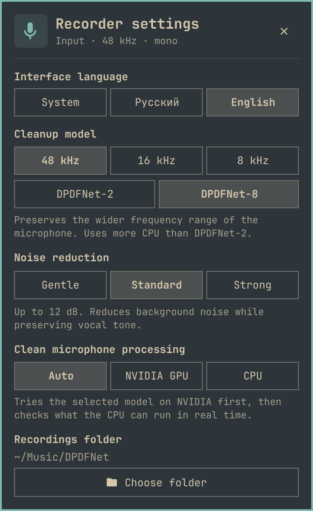

# Omarchy Voice Recorder

Record from the default microphone, clean up background noise locally and listen to both versions from the Omarchy bar. Click the microphone beside World Clocks to open the controls. Right-click it to start recording, then right-click again to stop and clean the take. You can close the panel while you speak.


## Record and compare

1. Open the gear menu to choose a save folder, model and noise suppression limit. The recording default is DPDFNet-8 HR at 48 kHz and 12 dB. Choose 6 dB to retain more of the room or 24 dB for stronger suppression.
2. Start a recording. The microphone indicator shows when recording is active. Stop when you finish speaking. DPDFNet then processes the take on the CPU.
3. Play the original and cleaned versions in the panel. To compare another setup on the same phrase, select a different model or strength and reprocess the latest take. Each new combination produces a separate result from the original WAV. Select a previously rendered combination to play it again immediately.



| Model group | Available models | When to try it |
| --- | --- | --- |
| 48 kHz | DPDFNet-2 HR, DPDFNet-8 HR | Preserve the widest frequency range of a microphone recording. |
| 16 kHz | Baseline, DPDFNet-2, DPDFNet-4, DPDFNet-8 | Compare speech-focused models, including the lightweight baseline. |
| 8 kHz | DPDFNet-2, DPDFNet-8 | Try narrowband, telephone-style speech. |

The default destination is `DPDFNet` under the XDG Music directory, usually `~/Music/DPDFNet`. Each timestamped take folder contains the 48 kHz mono `original.wav` and the initial `cleaned.wav`. Additional versions are stored under `variants/`, for example `variants/dpdfnet8-24dB.wav`. This also works with takes recorded in version 0.1. Changing the destination applies to future takes. Settings are saved in `${XDG_CONFIG_HOME:-$HOME/.config}/omarchy-voice-recorder/settings.json`.

## Live microphone for calls and streams

Open the recorder panel and enable **Clean microphone**. In the calling app, browser or OBS, choose **DPDFNet Clean Microphone** as the audio input. The plugin processes your system microphone locally and feeds the result directly to that input. Closing the panel keeps the audio flowing. Disable the switch when you finish.

In settings, choose the device for **live processing**. **Auto** tries the selected model on NVIDIA when the optional CUDA engine is installed, then tries the CPU. **NVIDIA GPU** requires CUDA and keeps your chosen model. **CPU** uses the processor and can choose a lighter model at the same sample rate. A startup timing check determines whether the engine can sustain the stream. The panel shows the active model and device. Switch the clean microphone off and on to apply a new choice. Saved recordings use the selected model and run on the CPU after capture.

The language setting offers **System**, **English** and **Русский**. The change applies immediately across the plugin’s panels and bar tooltips.

## Install

Tested on Omarchy 4.5 with Quickshell, PipeWire, system Python 3, GTK 4.10+ and PyGObject. The folder picker uses GTK. The virtual microphone uses `pw-cat`, `pw-dump` and `pactl` with PipeWire’s PulseAudio compatibility service. To install a missing system dependency on Omarchy, use `omarchy pkg add` with the relevant package name (`python`, `python-gobject`, `gtk4`, `pipewire`, `pipewire-audio`, `pipewire-pulse`, `libpulse`, `xdg-utils`, `xdg-user-dirs` or `uv`).

Install the widget from GitHub, then run the per-user engine installer:

```sh
omarchy plugin add https://github.com/i4w7w4a/omarchy-voice-recorder.git
"$HOME/.config/omarchy/plugins/re_pick.voice-recorder/scripts/install-engine"
omarchy plugin enable re_pick.voice-recorder --after omarchy.elsewhen
```

If World Clocks is absent, use `omarchy plugin enable re_pick.voice-recorder --section centerEnd`.

For NVIDIA live acceleration, install a working NVIDIA driver and run the optional GPU setup:

```sh
"$HOME/.config/omarchy/plugins/re_pick.voice-recorder/scripts/install-gpu"
```

GPU setup downloads ONNX Runtime and the NVIDIA CUDA libraries into a separate per-user environment. Both engines use the same model cache. The tested GPU environment takes about 2.8 GiB of disk space, plus the package manager’s download cache. Driver installation is managed separately by your distribution.

On a GeForce GTX 1080 Ti with the NVIDIA 580.178.04 driver, DPDFNet-8 HR at 48 kHz took **7.53 ms per 10 ms hop** at the median and **8.69 ms** at the 95th percentile over 1,000 warmed-up hops. This measures processing time on an active desktop. PipeWire and the calling app add buffering. Other GPUs and workloads should use the startup check on their own hardware.

The engine installer uses `uv` to set up a private Python 3.13 environment under `${XDG_DATA_HOME:-$HOME/.local/share}/dpdfnet/venv`, install `dpdfnet==0.6.0` from PyPI and download all eight official ONNX models. The standard model location is `${XDG_CACHE_HOME:-$HOME/.cache}/dpdfnet/models`. Run `./scripts/install-engine` again to upgrade a single-model installation or resume an interrupted download. It reuses completed files and checks that each model opens. An existing DPDFNet executable on the shell’s `PATH` with the selected model in its cache is also supported. Recording, enhancement and playback work offline after setup. [DPDFNet](https://github.com/ceva-ip/DPDFNet) · [Pretrained models](https://huggingface.co/Ceva-IP/DPDFNet)

To run the controller tests from a checkout, use `python3 -m unittest discover -s tests -v`. The tests use a synthetic audio source and temporary directories.

## Remove

Finish the active take and switch off Clean microphone, then run `omarchy plugin remove re_pick.voice-recorder`. Your takes stay in the selected recording folder. Omarchy removes the widget independently of the Python environment and model, which may also serve other audio tools.

## По-русски

Нажмите микрофон рядом с мировыми часами, чтобы открыть панель. Правая кнопка запускает запись, повторное нажатие останавливает её и запускает очистку. В настройках под шестерёнкой выберите папку, модель и силу шумоподавления. По умолчанию для записи выбраны DPDFNet-8 HR, 48 кГц и 12 дБ.

Для звонка или стрима включите **«Чистый микрофон»** и выберите **DPDFNet Clean Microphone** в списке микрофонов нужного приложения. Для работы на видеокарте выполните `scripts/install-gpu` и выберите **NVIDIA GPU** в настройках. Панель покажет активную модель и устройство. При смене устройства выключите и снова включите чистый микрофон. Язык интерфейса можно переключить между системным, русским и английским прямо в настройках.

Чтобы сравнить модели на одной фразе, измените настройки и запустите повторную обработку последнего дубля. Плагин возьмёт `original.wav` и сохранит результат отдельным WAV в подпапке `variants/`. Первый `cleaned.wav` останется рядом с исходником. Выберите уже обработанную комбинацию модели и силы, чтобы сразу её прослушать. Если у вас была версия с одной моделью, выполните `./scripts/install-engine` из каталога плагина, чтобы догрузить остальные.

## License

The widget and helper scripts use the MIT license. DPDFNet and its models are downloaded separately and distributed by their authors under Apache 2.0. [Widget license](LICENSE) · [DPDFNet license](https://github.com/ceva-ip/DPDFNet/blob/main/LICENSE)
