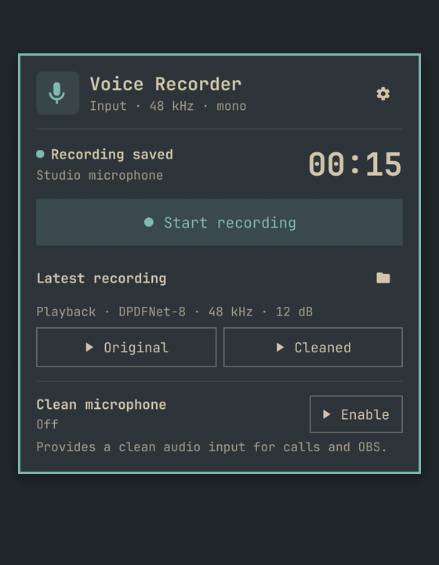
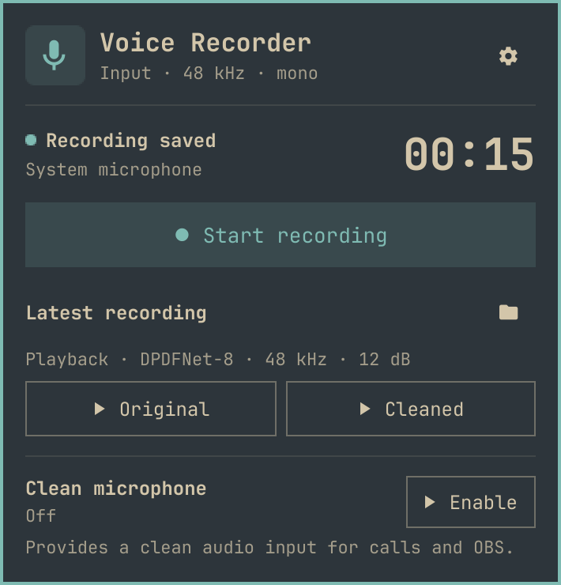
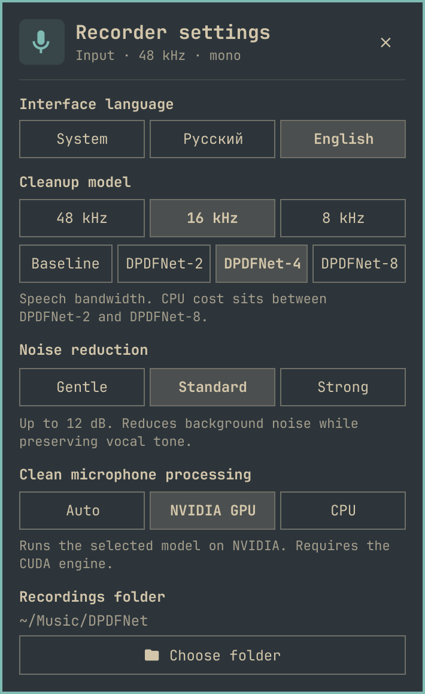

# 🎙️ Omarchy Voice Recorder

**Give OBS, Discord and browser calls a clean microphone while you speak.** This Omarchy bar widget uses DPDFNet to reduce background noise locally and sends your voice to a virtual input called **DPDFNet Clean Microphone**.

You can also record a voice-over straight from the bar. Keep the original WAV, listen to it alongside the cleaned take, and try another model on the same phrase. Once the engine and models are installed, recording and cleanup work offline.



[Quick start](#quick-start) · [Live microphone](#live-microphone) · [Record and compare](#record-and-compare) · [Performance](#performance) · [По-русски](#russian)

<a id="quick-start"></a>

## ⚡ Quick start

Install the plugin and its local engine on your Omarchy desktop.

```sh
omarchy plugin add https://github.com/i4w7w4a/omarchy-voice-recorder.git
"$HOME/.config/omarchy/plugins/re_pick.voice-recorder/scripts/install-engine"
omarchy plugin enable re_pick.voice-recorder --after omarchy.elsewhen
```

The installer uses `uv`. If it is missing, run `omarchy pkg add uv` first. If your bar has no World Clocks widget, use `omarchy plugin enable re_pick.voice-recorder --section centerEnd` for the last command.

Click the **microphone** beside World Clocks. Choose **Enable** under **Clean microphone** to use it in a stream, or **Start recording** to save a take. A **right-click** on the bar microphone starts a recording directly. Right-click again to stop and clean it.

<a id="live-microphone"></a>

## 🔴 Live microphone

Leave your physical microphone selected as the system input. Enable **Clean microphone** in the panel, then choose **DPDFNet Clean Microphone** in the app that should receive the audio.

| App | Where to select it |
| --- | --- |
| **OBS Studio** | **Settings → Audio → Mic/Auxiliary Audio** |
| **Discord** | **User Settings → Voice & Video → Input Device** |
| **Browser call** | The meeting’s **Microphone** or **Audio input** menu. Allow microphone access when the browser prompts. |

The stream keeps running when you close the panel. The panel shows the active model and processing device. Switch **Clean microphone** off and on to apply new settings, and disable it when you finish the call.

<a id="record-and-compare"></a>

## 🎧 Record and compare

1. Click **Start recording**, speak, then click **Stop and clean**. The plugin saves a mono 48 kHz WAV and cleans the take on the CPU.
2. Under **Latest recording**, listen to **Original** and **Cleaned**. To try another sound, open the gear menu, choose a model or noise reduction level, then return and click **Apply to this recording**.
3. Each new combination renders from the same original. Pick a previously rendered combination for immediate playback. The folder button opens the take and all its versions in your file manager.

Closing the panel lets a recording continue. Disabling the widget or removing it from the bar stops microphone capture and saves the audio collected so far in the take’s `original.wav`.

The default is **DPDFNet-8 at 48 kHz** with **Standard (12 dB)** noise reduction. Try **Gentle (6 dB)** to keep more room sound, or **Strong (24 dB)** for louder backgrounds. Stronger suppression can soften quiet speech.

| Model group | Choices in settings | Audio bandwidth |
| --- | --- | --- |
| **48 kHz** | DPDFNet-2, DPDFNet-8 | Fullband microphone audio. These are the upstream HR models. |
| **16 kHz** | Baseline, DPDFNet-2, DPDFNet-4, DPDFNet-8 | Wideband speech, including the lightweight Baseline model. |
| **8 kHz** | DPDFNet-2, DPDFNet-8 | Narrowband, telephone-style speech. |

Use **Settings → Recordings folder → Choose folder** to set the destination for future takes. The default is `DPDFNet` in your XDG Music directory, usually `~/Music/DPDFNet`. Each timestamped folder contains `original.wav` and the initial `cleaned.wav`. Later versions appear under `variants/`, for example `variants/dpdfnet8-24dB.wav`. Earlier takes keep their files when you change settings.

<details>
<summary><strong>📷 See the recorder, live input and settings panels</strong></summary>

| Recorder and playback | Live microphone |
| :---: | :---: |
|  |  |

| Fullband models · Auto | Wideband models · NVIDIA GPU |
| :---: | :---: |
|  |  |

</details>

<a id="performance"></a>

## ⚙️ CPU, NVIDIA and real-time performance

The standard install runs on the CPU. To enable NVIDIA acceleration for the **live microphone**, install a working NVIDIA driver and run the GPU setup.

```sh
"$HOME/.config/omarchy/plugins/re_pick.voice-recorder/scripts/install-gpu"
```

Open **Settings → Clean microphone processing** to choose a device.

| Device setting | What happens when you enable the live microphone |
| --- | --- |
| **Auto** | Tries the chosen model on NVIDIA if the GPU engine is installed, then tries the CPU. |
| **CPU** | Measures the chosen model and can switch to a lighter model at the same sample rate to keep up with speech. |
| **NVIDIA GPU** | Uses the chosen model on CUDA. If it misses the real-time budget, select a lighter model or switch to Auto. |

**Measured on one desktop.** Each row times 1,000 warmed-up 10 ms blocks of synthetic 48 kHz audio. A live model has 10 ms to process each block.

| Processing device | Model | Median per block | 95th percentile |
| --- | --- | ---: | ---: |
| GeForce GTX 1080 Ti · NVIDIA 580.178.04 | DPDFNet-8 HR | 7.53 ms | 8.69 ms |
| Intel Xeon E5-2660 v2 | DPDFNet-8 HR | 14.35 ms | 15.54 ms |
| Intel Xeon E5-2660 v2 | DPDFNet-2 HR | 5.21 ms | 5.88 ms |

These timings cover model processing. End-to-end latency also includes microphone capture, the model’s analysis window, PipeWire buffering and the receiving app. The plugin checks live performance on your hardware at startup.

<details>
<summary><strong>System requirements, disk usage and engine paths</strong></summary>

Tested on Omarchy 4.5 with Quickshell and PipeWire. The recorder uses system Python 3. The folder chooser uses GTK 4.10+ and PyGObject. Live audio uses `pw-cat`, `pw-dump` and `pactl` with PipeWire’s PulseAudio compatibility service. On Omarchy, install missing packages with `omarchy pkg add`. Package names include `python`, `python-gobject`, `gtk4`, `pipewire`, `pipewire-audio`, `pipewire-pulse`, `libpulse`, `xdg-utils`, `xdg-user-dirs` and `uv`.

- **CPU engine.** `scripts/install-engine` uses `uv` to create a per-user Python 3.13 environment in `${XDG_DATA_HOME:-$HOME/.local/share}/dpdfnet/venv`, install `dpdfnet==0.6.0` and fetch all eight official ONNX models. You can rerun it after an interrupted download or to upgrade an older single-model install. It fetches models from a fixed publisher revision and checks the size and SHA-256 of downloaded and cached weights. The file and live engines verify the selected bytes again before loading them. [Pinned model hashes](scripts/model_weights.json) · [Upstream snapshot](https://huggingface.co/Ceva-IP/DPDFNet/tree/dd6818d00f50c836fed43a6243ebe49116de5964/onnx)
- **GPU engine.** `scripts/install-gpu` creates a separate Python 3.12 environment under `${XDG_DATA_HOME:-$HOME/.local/share}/dpdfnet/gpu-venv` for ONNX Runtime GPU and CUDA 12 libraries. The tested GPU environment uses about **2.8 GiB**, plus the package download cache.
- **Shared model cache.** Both engines use `${XDG_CACHE_HOME:-$HOME/.cache}/dpdfnet/models` by default. The CPU recorder can also use an existing `dpdfnet` on the shell’s `PATH` with the selected model cached.
- **Preferences.** Settings live at `${XDG_CONFIG_HOME:-$HOME/.config}/omarchy-voice-recorder/settings.json`. Set **Interface language** to **System**, **English** or **Русский** for an immediate update.

</details>

<a id="russian"></a>

## По-русски

**Для стрима или звонка.** После установки нажмите значок микрофона рядом с мировыми часами. Включите **«Чистый микрофон»**, затем выберите **DPDFNet Clean Microphone** в OBS, Discord или настройках звука браузерного звонка. Панель можно закрыть. Для работы на NVIDIA установите GPU-движок командой выше и выберите **NVIDIA GPU** в настройках. Чтобы применить новые параметры к текущему потоку, выключите и снова включите чистый микрофон.

**Для записи.** Нажмите значок правой кнопкой, произнесите фразу и нажмите ещё раз, чтобы закончить запись и запустить очистку. В панели можно прослушать исходник и очищенный голос. В настройках под шестерёнкой выбираются папка, модель и сила подавления. Чтобы сравнить две настройки на одной фразе, выберите вторую комбинацию и примените её к этой записи. Новый WAV появится в `variants/` рядом с исходными файлами дубля.

При отключении виджета диктофон останавливает захват микрофона и сохраняет уже записанный звук в `original.wav`. Простое закрытие панели позволяет продолжать запись.

## Uninstall

Run `omarchy plugin remove re_pick.voice-recorder` to uninstall. Removing the widget stops an active capture and finalizes the recorded audio. Your takes stay in the folder you chose. The Python environments and model cache are separate from the widget and may also serve other audio tools.

## Development and license

From a checkout, run `python3 -m unittest discover -s tests -v`. The controller tests use synthetic audio and temporary directories.

The widget and its helper scripts use the MIT license. The engine installer downloads Ceva’s DPDFNet and pretrained models separately, under Apache 2.0. [Widget license](LICENSE) · [DPDFNet source and license](https://github.com/ceva-ip/DPDFNet) · [Pretrained models](https://huggingface.co/Ceva-IP/DPDFNet)
