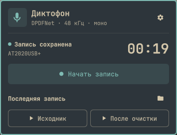

# Omarchy Voice Recorder

Record from the default microphone, clean up background noise locally and listen to both versions from the Omarchy bar. Click the microphone beside World Clocks to open the controls. Right-click it to start recording, then right-click again to stop and clean the take. You can close the panel while you speak.



## Record and compare

1. Open the gear menu to choose a save folder and the amount of noise suppression. The default limit is 12 dB. Choose 6 dB to retain more of the room or 24 dB for stronger suppression.
2. Start a recording. The microphone indicator shows when recording is active. Stop when you finish speaking. DPDFNet then processes the take on the CPU.
3. In the panel, play the original and cleaned versions. Open the take’s folder to use the WAV files in another application.

The default destination is `DPDFNet` under the XDG Music directory, usually `~/Music/DPDFNet`. Each take gets a timestamped subdirectory containing `original.wav` and `cleaned.wav`, both mono, 48 kHz. Changing the destination applies to future takes. The folder and suppression limit are saved in `${XDG_CONFIG_HOME:-$HOME/.config}/omarchy-voice-recorder/settings.json`.

## Install

Tested on Omarchy 4.5 with Quickshell, PipeWire, system Python 3, GTK 4.10+ and PyGObject. The folder picker uses GTK, and playback uses `pw-play`. To install a missing system dependency on Omarchy, use `omarchy pkg add` with the relevant package name (`python`, `python-gobject`, `gtk4`, `pipewire-audio`, `xdg-utils`, `xdg-user-dirs` or `uv`).

From a checkout of this repository, install the engine once and link the widget into your shell.

```sh
./scripts/install-engine
omarchy plugin validate .
mkdir -p "$HOME/.config/omarchy/plugins"
ln -sT -- "$PWD" "$HOME/.config/omarchy/plugins/re_pick.voice-recorder"
omarchy-shell shell rescanPlugins
omarchy plugin enable re_pick.voice-recorder --after omarchy.elsewhen
```

If World Clocks is absent, use `omarchy plugin enable re_pick.voice-recorder --section centerEnd`. For a Git-managed install from a published repository, use `omarchy plugin add <git-url>`, then run `~/.config/omarchy/plugins/re_pick.voice-recorder/scripts/install-engine` and the same enable command.

The engine installer uses `uv` to set up a private Python 3.13 environment under `${XDG_DATA_HOME:-$HOME/.local/share}/dpdfnet/venv`, install `dpdfnet==0.6.0` from PyPI and fetch the official `dpdfnet2_48khz_hr` model. The standard model location is `${XDG_CACHE_HOME:-$HOME/.cache}/dpdfnet/models`. An existing DPDFNet executable on the shell’s `PATH` with the same model is also supported. Recording, enhancement and playback work offline after setup. [DPDFNet](https://github.com/ceva-ip/DPDFNet) · [Pretrained model](https://huggingface.co/Ceva-IP/DPDFNet)

To run the controller tests from a checkout, use `python3 -m unittest discover -s tests -v`. The tests use a synthetic audio source and temporary directories.

## Remove

Finish the active take, then run `omarchy plugin remove re_pick.voice-recorder`. Your takes stay in the selected recording folder. Omarchy removes the widget independently of the Python environment and model, which may also serve other audio tools.

## По-русски

Нажмите микрофон рядом с мировыми часами, чтобы открыть панель записи. Правая кнопка запускает запись, повторное нажатие останавливает её и очищает голос. В настройках под шестерёнкой можно выбрать папку и силу подавления шума. Когда обработка завершится, прослушайте исходник и очищенную версию или откройте папку дубля.

## License

The widget and helper scripts use the MIT license. DPDFNet and its model are downloaded separately and distributed by their authors under Apache 2.0. [Widget license](LICENSE) · [DPDFNet license](https://github.com/ceva-ip/DPDFNet/blob/main/LICENSE)
